<div align="center">

# nudg

**The interaction format your AI can nudge.**

[](https://www.npmjs.com/package/@nudg/core)
[](https://github.com/seukwoo/nudg/actions/workflows/ci.yml)
[](LICENSE)

<a href="https://seukwoo.github.io/nudg/demo/">
  <picture>
    <source media="(prefers-color-scheme: dark)" srcset="docs/media/hero-dark.svg">
    
  </picture>
</a>

**[Try all 48 examples in the live demo →](https://seukwoo.github.io/nudg/demo/)**

</div>

nudg describes a UI interaction in a small JSON file next to your component: its states, the events that move between them, and the motion in between. Your AI coding tool edits the file, nudg checks the edit, and a tiny runtime plays it in your app.

## Think of it as sheet music

| | |
|---|---|
| **The `.nudg.json` file** is the score | which parts move, in which states, and how they get there |
| **The runtimes** are the rules of performance | TypeScript, Swift and Kotlin play the same score the same way, and a shared conformance suite proves it |
| **Your AI** is the arranger | "bouncier" changes one marking, not the whole piece |
| **You** are the director | you watch before and after, side by side, and pick the better take |

## Say "bouncier", see before and after, judge

```diff
   "animate": {
-    "knob.x": { "spring": { "duration": 0.35, "bounce": 0.25 } },
+    "knob.x": { "spring": { "duration": 0.35, "bounce": 0.6 } },
```

<picture>
  <source media="(prefers-color-scheme: dark)" srcset="docs/media/bouncier-dark.svg">
  
</picture>

Everyday words map to single fields: *bouncier* is `bounce`, *slower* is `duration`. The component code doesn't change.

And it shows you, without being asked. `nudg_compare` plays both versions under the same tap and says first whether you'd even notice (*"A clear change: knob.x moves up to 2.1 units differently, settles 0.23 s later"*, or *"Nothing a person will notice; look at an exaggerated version first"*), then lays real frames of before and after side by side. You judge by looking.

## A whole interaction in one file

This is the toggle above, complete:

```json
{
  "nudg": "0.1",
  "targets": ["knob", "track"],
  "values": { "knob.x": 0, "track.color": "#D1D5DB" },
  "animate": {
    "knob.x": { "spring": { "duration": 0.35, "bounce": 0.25 } },
    "track.color": { "tween": { "duration": 0.2, "ease": "out" } }
  },
  "initial": "off",
  "states": {
    "off": { "when": { "track.tap": "on" } },
    "on": {
      "set": { "knob.x": 20, "track.color": "#4ADE80" },
      "when": { "track.tap": "off" }
    }
  }
}
```

- **States say where.** In `on`, the knob sits at 20 and the track is green.
- **`animate` says how.** The knob springs there; the color tweens.
- **`when` says what moves between states.** A tap on the track.

Interrupt it mid-flight and the spring carries its velocity into the new direction, with nothing extra to write.

Your component binds its parts by name, and nudg plays the file on them:

```tsx
import { useNudg } from "@nudg/core/react";
import toggle from "./toggle.nudg.json";

function Toggle() {
  const { bind } = useNudg(toggle);
  return (
    <button ref={bind("track")}>
      <span ref={bind("knob")} />
    </button>
  );
}
```

Values go straight to the elements' styles, so the component doesn't re-render while things move. Not using React? The DOM adapter binds `data-nudg="knob"` attributes instead; see [Using nudg](docs/usage.md#dom-adapter).

## Native feel, one import

nudg ships the platforms' own motion as libraries in the same format: SwiftUI's springs, and Material 3's motion tokens, copied from their published values. They share common names like `standard`, `quick` and `playful`, so switching an interaction from iOS feel to Android feel is a one-line diff:

```diff
-  "import": ["./motion/apple.nudg.json"],
+  "import": ["./motion/material-expressive.nudg.json"],
   "animate": { "knob.x": "standard", "track.color": "fade" }
```

See [platform motion](docs/usage.md#native-feel-on-every-platform) for every name and value.

## UI words become standard interactions

People don't usually ask for `duration: 0.35` and `bounce: 0.2`. They say "make this a FAB", "use tabs", "show it as a bottom sheet", "let the row swipe to delete", or "make the toast feel more iOS". nudg is built to make those words map to reusable interaction patterns instead of one-off code guesses.

The direction is mobile-first: patterns such as `fab`, `tab-bar`, `bottom-sheet`, `toast` / `snackbar`, `swipe-row`, `carousel`, `switch`, `slider`, `dialog`, `list`, `grid`, `voice-chat`, `video-call`, `camera`, `music-player` and `video-player` should come with expected parts, states, gestures and platform motion. The host still owns the markup, layout and device APIs; nudg supplies the interaction behavior that an AI can edit and a person can judge.

```txt
human UI words
  -> semantic pattern
  -> states, events, targets and motion
  -> compare / observe
```

## Get started

```sh
npm install @nudg/core
```

Give your AI agent the nudg tools over MCP. This is for Claude Code; any MCP client can run the same command:

```sh
claude mcp add nudg -- npx -y @nudg/core mcp
```

Or use the CLI yourself:

```sh
npx nudg validate toggle.nudg.json
npx nudg simulate toggle.nudg.json --send track.tap@0.1
```

Node 22.4 or later. See [Using nudg](docs/usage.md) for every command and option.

## Natural-language UI starts from a recipe

nudg maps familiar UI terms to versioned interaction contracts instead of asking an AI to reinvent them. A recipe names the expected parts, states, events, continuous inputs, host responsibilities, motion, known format gaps, and a validated starter:

```sh
npx nudg recipe "video chat"
npx nudg recipe sheet --json
npx nudg recipe toggle --source > toggle.nudg.json
```

The catalog covers every shipped example, from switches, tabs and sheets to voice chat, camera and media players. Patterns the format can't express yet, such as menus, spinners and screen transitions, are listed too, without a starter, so the AI says which part the host does instead of improvising. Recipes remain ordinary nudg documents at runtime; they guide generation without making the core component-specific.

## The simple case is one line

A press, a hover, a toggle or a toast needs no file. Presets are ready-made nudg documents:

```tsx
import { useNudg, presets } from "@nudg/core/react";

const { bind } = useNudg(presets.press({ scale: 0.96 }));
<button ref={bind("button")}>Save</button>
```

```js
import { playDoc } from "@nudg/core/dom";
import { presets } from "@nudg/core";

playDoc(presets.toast({ duration: 3 }), document.querySelector(".toast"));
```

When the options aren't enough, `nudg preset press > press.nudg.json` writes the same document as a file, and from there it's yours to edit, or your AI's.

## Your AI checks its own work

An agent can't watch an animation, so nudg tells it what happened, in text and in pictures:

| Tool | What the agent gets |
|---|---|
| `recipe` | A standard interaction contract and validated starter for a human UI term such as toggle, sheet or video chat. |
| `validate` | Each problem with a stable code, a JSON pointer, and a hint that says how to fix it. |
| `simulate` | States and values over time for a list of events: "the knob overshoots to 20.57 and is at rest from 0.84 s". |
| `plot` | A motion graph of every property, like the one below. |
| `render` | Real frames of your component, captured in a headless browser. |
| `compare` | Before and after under the same tap: whether a person would notice, then both side by side, and a page that plays them in slow motion. Point it at the running app and it opens in your browser. |
| `critique` | Whether the motion is good, not only valid: too slow, late press feedback, invisible, bouncy fades, slow exits, short timeouts, no Escape. Each with a fix and its source. |
| `observe` | Host truth: the real page, tapped and measured every frame, judged against the file. "The element left the page at 0.18 s; the release is never shown." |

The examples site's playground has the same judge view live: **Compare with original** plays the original beside your edit, a tap on either reaches both, slow motion is a select, and the verdict updates as you type.


<sub>`nudg plot` output for the toggle, tapped again while still moving. The spring turns around smoothly instead of restarting.</sub>

## How it works

The nudg core never draws anything. Events go in, property values come out, and a thin adapter applies them to your views:

```
 your app (web, React Native, SwiftUI, Compose, ...)
   │  events: tap, drag, hover, focus, app events
   ▼
 ┌──────────────── nudg core ────────────────┐
 │  states + clock + motion math (headless)   │
 └────────────────────────────────────────────┘
   │  values: knob.x = 18.3, track.color = #4ADE80
   ▼
 adapter sets them on your views
```

- **Deterministic.** The same events at the same times always give the same values, so motion can be tested like any other code.
- **Portable.** Any platform that can set a property and send an event can run nudg. The spec and a language-neutral [conformance suite](spec/conformance/) define the behavior, not one implementation.
- **Just JSON.** No new syntax, no studio, readable diffs. The current [JSON Schema](spec/nudg-0.17.schema.json) gives editors completion, and the package exports its latest version as `@nudg/core/schema.json`.

## Why

Interactive animation usually lives in binary files made in a dedicated studio. An AI can't edit them, a reviewer can't read the diff, and every small change goes back through that one tool. nudg keeps interactions as text in your repo, where your AI coding tool already works. [More on the design](docs/design.md).

## Status

**Early, and moving.** Version 0.13 (format 0.16) is [on npm](https://www.npmjs.com/package/@nudg/core) with semantic recipes for common app patterns, taps, hovers, drags, throws and glides, long press and double tap, keyboard events, scroll direction and input thresholds, pausable timers, continuous app and scroll inputs, measured layout, entry keyframes, loops, staggered delays, screen transitions, a declared host interface, reduced motion, type-safe host names (`nudg generate`), one "motion is over" callback (`onSettle`) on every platform, server rendering without a flash, and adapters for the DOM, React (with bridges to MUI, Radix and shadcn/ui), React Native, SwiftUI and Jetpack Compose. The format may still change before 1.0; see the [changelog](CHANGELOG.md).

The [roadmap](docs/roadmap.md) tracks development priorities and stage status, from component interactions through screens and flows, native adapters and exploratory standalone content. Mobile-first semantic patterns build on that progression.

## Documentation

- [The nudg format](docs/spec.md): the full grammar.
- [Using nudg](docs/usage.md): the CLI, the MCP server, the adapters (DOM, React, React Native, SwiftUI, Compose), and platform motion.
- [Design](docs/design.md): principles, scope, decisions, and open questions.
- [Roadmap](docs/roadmap.md): the development plan, current status and completion criteria.
- [Coverage](docs/coverage.md): what the format can express, by trigger, response and structure, and where it runs.
- [Guide for AI agents](spec/guide.md): the format on one page; the [editing contract](docs/usage.md#the-editing-contract-for-ai-tools) lists everything an AI tool can rely on.
- [Development log](docs/devlog.md): problems met while building nudg, and how they were resolved.

## With the components you already use

nudg gives motion to the components you already have; it doesn't replace them. With shadcn/ui, Radix, Headless UI or React Aria, `useNudg(file, { watch: true })` follows the state they show (`data-state`, `aria-*`). With MUI, Ant Design or React Bootstrap, `nudgTransition(file)` plugs into their transition slot. The library keeps behavior and accessibility; the file holds the feel, where an AI can tune it and you can judge it. See [Using nudg](docs/usage.md#with-component-libraries).

## Help nudg get better

nudg's goal is that a motion change takes one round: you say a word, see before and after, and judge. Whether it does is measured on your machine, in a local log that never leaves it by itself. If you use nudg, please share it now and then:

```sh
npx @nudg/core log --share
```

It shows exactly what it would send (counts only: rounds per change, verdicts, tool calls; no file names, paths or code) and opens a GitHub issue for you to read and submit.

## Contributing

Issues and pull requests are welcome. nudg is designed before it is coded, so for anything beyond a bug fix, please open an issue first to talk through the interaction you want to build. See [CONTRIBUTING.md](CONTRIBUTING.md).

## License

[MIT](LICENSE)
